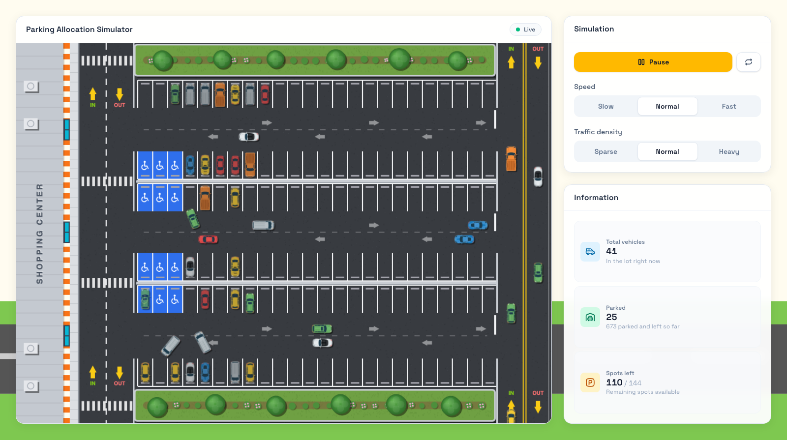
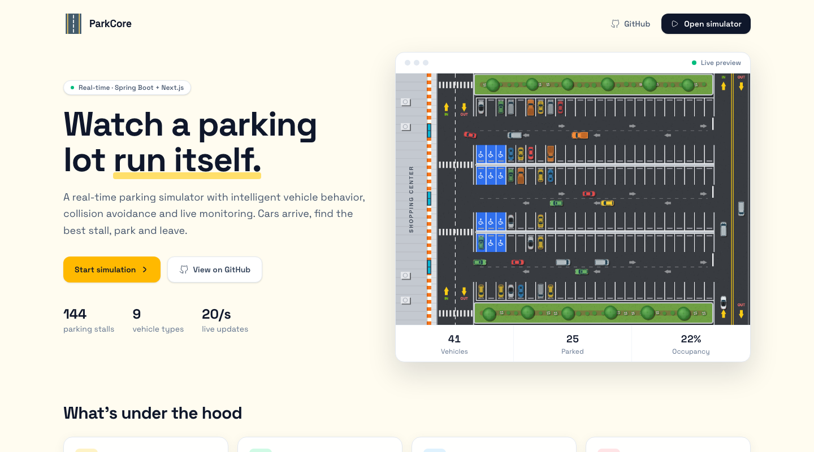
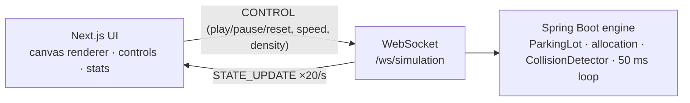

# ParkCore

**Try it: [parkcore-frontend.onrender.com](https://parkcore-frontend.onrender.com)** (the free server
may take a minute to wake up on the first visit).

A real-time parking lot simulator: a Spring Boot engine that runs the lot and streams it over
WebSocket, and a Next.js canvas UI that draws it at 60fps.

- **The simulator:** watch cars arrive at a shopping center, get assigned a stall, pull in,
  park, back out and leave. Pause it, reset it, speed it up or flood it with traffic, and
  follow occupancy live.
- **The engine:** every 50 ms it spawns arrivals, allocates the free stall closest to the
  store, moves every vehicle along its route while yielding to traffic ahead, and broadcasts
  the whole lot to every connected browser.

This repo is the frontend. The engine lives in
[Parkcore-Backend](https://github.com/XuanGiaHanNguyen/Parkcore-Backend).



## Quick start

Start the backend (JDK ≥ 21), then the frontend (Node ≥ 20):

```bash
git clone https://github.com/XuanGiaHanNguyen/Parkcore-Backend.git
cd Parkcore-Backend && ./mvnw spring-boot:run          # WebSocket on ws://localhost:8085/ws/simulation

git clone https://github.com/XuanGiaHanNguyen/Parkcore-Frontend.git
cd Parkcore-Frontend && npm ci && npm run dev          # UI on http://localhost:3000
```

The UI connects to `ws://localhost:8085/ws/simulation` unless `NEXT_PUBLIC_WS_URL` says
otherwise (put it in `.env.local`).

### Deploy

Both repos ship a [Render](https://render.com) blueprint (`render.yaml`). In the dashboard,
**New → Blueprint**, pick the repo and apply:

- **Backend:** a Docker web service built from its `Dockerfile`. On the free plan it sleeps
  after about 15 idle minutes, and the first visit after that takes about a minute while it
  wakes (the UI shows *Connecting…* and reconnects on its own).
- **Frontend:** a static site. `next.config.ts` exports the app to plain HTML/JS in `out/`,
  served from Render's CDN, which never sleeps. `NEXT_PUBLIC_WS_URL` in `render.yaml` points
  it at the backend (`wss://…`, since the site is served over HTTPS). It's baked in at build
  time, so redeploy after changing it.

Both deploy automatically from `main`. The frontend also works on Vercel or Netlify as-is.

## What you can do

**Watch the lot.** 144 stalls in six rows around three aisles, next to a shopping center.
Cars come up the entrance road, turn into an aisle, pull nose-first into their stall and
stay a while. Then they wait for a gap, back out, loop around on the store-side road and
leave. Blue stalls closest to the store are handicapped spaces, used only by permit holders.
Police cars patrol the aisles without parking. The lot starts about 40% full so there's
something to watch right away.

**Control it.** *Play/Pause* freezes the whole lot and *Reset* starts it over. *Speed*
(slow, normal, fast) runs the simulation clock at 0.5×, 1× or 2×. *Traffic density*
(sparse, normal, heavy) changes how often cars arrive. Controls go to the server, so
every open browser sees the same lot and the same settings.

**Follow the numbers.** The side panel shows vehicles in the lot, how many are parked,
how many have parked and left, and spots left out of 144.



The landing page runs a live preview of the same simulation, with vehicle, parked and
occupancy counts.

## How the simulation works

### Allocation

When a car arrives, the engine picks among the four free stalls closest to the store,
at random so cars spread over the aisles. The stall is reserved for that car the moment
it enters, so two cars never head for the same stall. Cars with a handicapped permit (8%)
prefer the blue stalls. Everyone else never uses them. If the lot is full, nobody else
comes in until a stall frees up.

### Traffic rules

| Rule | What happens |
|---|---|
| Yield to traffic ahead | A car stops if another vehicle is in its path, within a car length plus a gap. Cars beside or behind it don't count, so opposite lanes never block each other. |
| Right of way | If two cars block each other (e.g. crossing paths), the one that arrived first goes. |
| Backing out | A parked car waits for a gap in the aisle before reversing (up to 6 s). |
| Deadlock breaker | A car stuck for 4 s gets a brief pass to push through. |
| Entrance | A new car only spawns when the entrance is clear and fewer than 16 cars are looking for a stall. |

### A visit

| State | Meaning |
|---|---|
| `MOVING` | Driving to its stall (or patrolling) |
| `STOPPED` | Waiting for traffic ahead |
| `PARKING` | Turning into the stall |
| `PARKED` | In the stall for 30–90 simulated seconds |
| `EXITING` | Backing out and driving off. The stall is freed once the car is back in the aisle. |

### Vehicles

| Type | Share | Size (px) | Speed (px/s) |
|---|---|---|---|
| Blue, red, green, white, yellow car | 12% each | 40 × 20 | 90 |
| Taxi | 10% | 40 × 20 | 95 |
| Van | 12% | 44 × 22 | 75 |
| Semi truck | 5% | 50 × 24 | 60 |
| Police (patrols, never parks) | 4% | 40 × 20 | 105 |

## Architecture



The backend is the single source of truth. It owns the lot, the routes and every
vehicle's position and state, and all clients share one simulation. The frontend only
draws: a pre-rendered background (store, roads, stalls, landscaping) plus a vehicle layer
redrawn every animation frame. Positions are eased toward the latest server update so
20 updates a second look smooth at 60fps.

The lot geometry exists twice and must match: `buildLayout` in
`src/app/simulation/roadsystem/parkinglot.tsx` and `ParkingLot.java` in the backend
(canvas 1000 × 710).

## WebSocket protocol

Server → client, every 50 ms:

```json
{ "type": "STATE_UPDATE",
  "payload": { "vehicles": [{ "id": "vehicle-12", "type": "TAXI", "x": 512.4, "y": 161.5,
                              "angle": 180, "speed": 90, "state": "MOVING", "spotId": "R1-4" }],
               "vehicleCount": 61, "parkedCount": 44, "totalSpots": 144, "spotsLeft": 89,
               "servedCount": 120, "running": true, "speed": "normal", "density": "normal",
               "avgSpeed": 71.2, "timestamp": 1761789012345 } }
```

Client → server (every field optional):

```json
{ "type": "CONTROL", "action": "play | pause | reset", "speed": "slow | normal | fast", "density": "sparse | normal | heavy" }
```

Coordinates are canvas pixels. `angle` is the direction the nose points, in degrees
(0 = right, 90 = down).

## Running the checks

```bash
npm run lint                 # ESLint
npx tsc --noEmit             # type check
npm run build                # static export to out/
```

## Repository layout

```
src/app/
  page.tsx                          landing page with the live preview
  caranimated.tsx                   animated road in the footer
  simulation/page.tsx               simulator: map, controls, stats
  simulation/roadsystem/
    parkinglot.tsx                  lot geometry, background drawing, render loop
    hooks/useSimulationSocket.ts    WebSocket connection, state, controls, reconnect
    lib/vehicleRenderer.ts          interpolation and vehicle drawing
    lib/vehicleAssets.ts            sprite paths, sizes, fallback colors
  layout.tsx, manifest.ts, sitemap.ts, robots.ts, icon.png
src/components/navigation.tsx       top bar
public/vehicles/                    vehicle sprites
docs/images/                        README screenshots
render.yaml                         Render static-site blueprint
```
